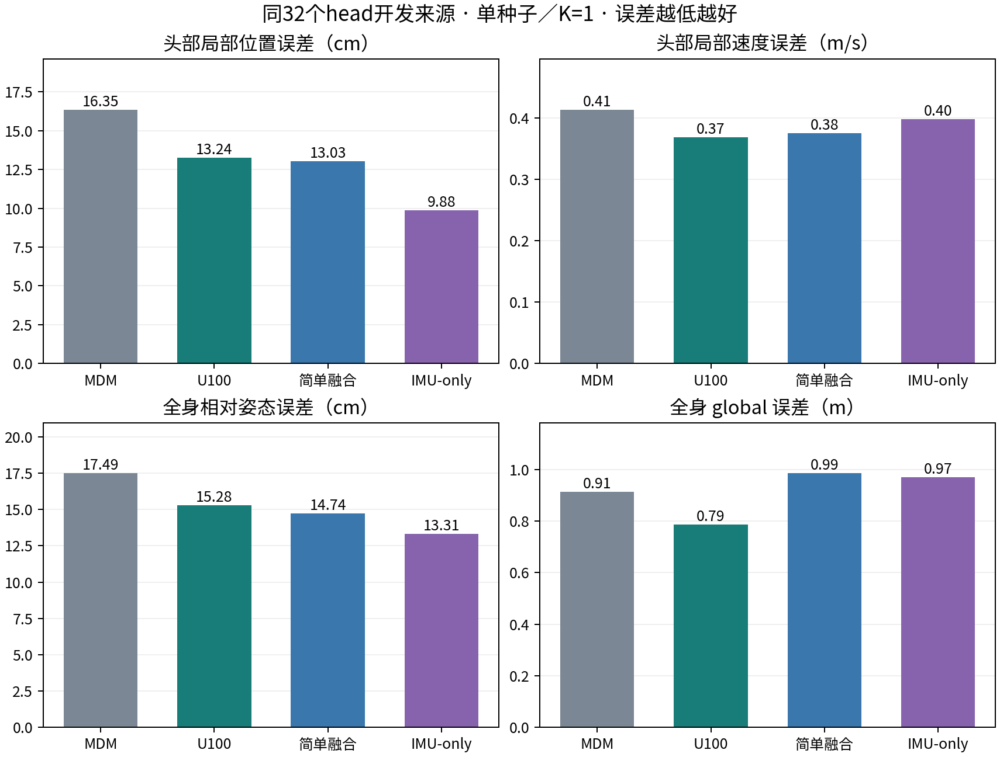
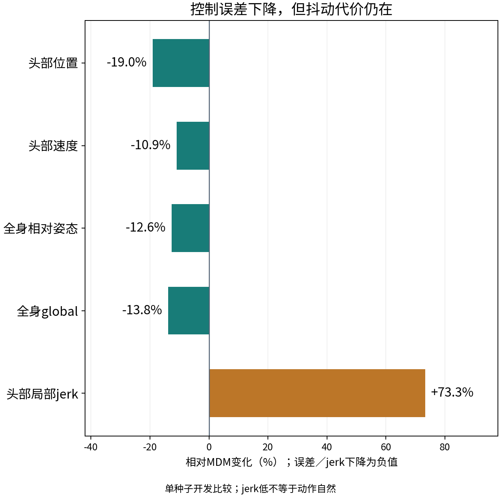
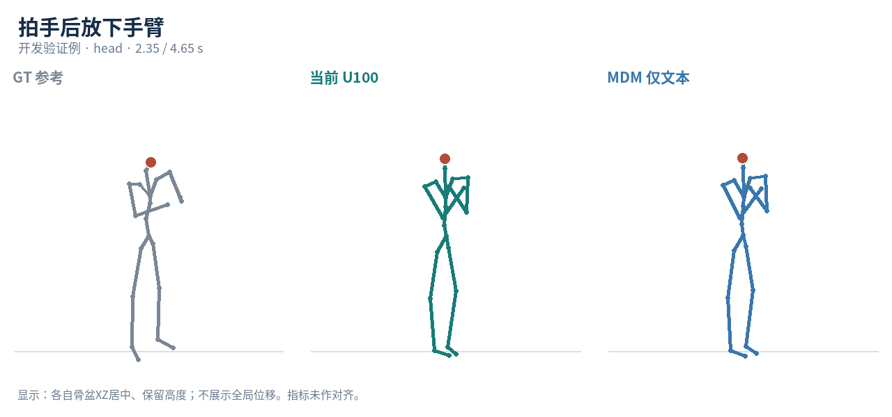
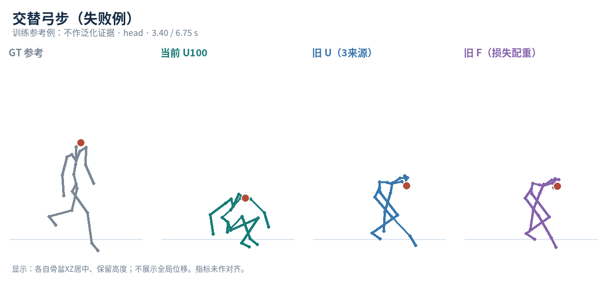

# ITM 导师汇报逐页讲稿

建议主稿约15–20分钟；01–22页为主稿，23–25页为附录。

表格和图来自同32来源开发比较；单种子/K=1，未认证语义、临床或最终论文优越性。

## 01 文本＋头部 IMU → 全身动作

课题进展与路线收敛 · 导师讨论 · 2026.10.10

**当前定位**

- 单头部 IMU 为主线
- 双腕作为扩展

**已完成**

- 完整原型＋共同开发比较
- 4 方法 × 32 来源

**待解决**

- 语义、强基线与核心消融
- 尚未冻结最终论文结论

**本页结论：**从“持续探索”转向“按论文交付推进”。

**建议讲述：**今天分三部分：先简单说明任务和意义；重点汇报当前实际方法、设置和结果；最后复盘为什么慢，以及下一阶段怎样收敛。基金摘要只作研究背景，不改变本文主线，也不虚构患者实验。

## 02 整体想法：让意图与实例信息互补

文本表达高层动作，头部 IMU 提供连续运动信息

**只有文本**

- 能说“走路、转身、抬腿”
- 难以描述某次表演的逐帧变化

**只有头部 IMU**

- 能观测头部加速度和朝向
- 不能唯一确定手脚和全身动作

**联合条件生成**

- 用动作先验补全稀疏观测
- 用文本选择目标动作内容

**本页结论：**目标是联合条件下的合理全身动作；未观测手脚不自动等同于真实测量。

**建议讲述：**这是欠定问题，不是一个头部传感器就能精确测量全身。当前研究假设是两种信息互补，互补是否真的有效还需要去条件、语义和动作质量评价。也不能默认任意文本与给定头部观测都相容。

## 03 应用：创作场景清晰，医院合作需具体落点

头部可穿戴输入的低负担优势，与基金方向保持一致

**影视／游戏创作**

- 局部表演＋语言指定动作
- 虚拟角色动作草稿与迭代
- 当前较直接的应用定位

**与基金的研究关联**

- 基金：智能耳机IMU与下肢重建
- 关联：耳／头惯性、稀疏观测
- 条件扩散与多维性能均衡

**当前边界**

- 本文仍是文本＋head动作生成
- 未实现双耳校准／实时精准重建
- 没有患者或临床有效性验证

**本页结论：**头部主线首先服务明确研究问题，再讨论真实设备和医院数据验证。

**建议讲述：**用户提供的基金摘要关注智能耳机双耳IMU、实时全局定标、物理约束与下肢运动学三维重建。这里只指出技术关联，不把本文改造成基金全部研究内容。合成head配置不是两个真实耳机IMU；没有双耳自监督校准、实时消除累积误差或临床验证。潜在医院用途仍需后续数据和专家需求，不能用生成的未观测手脚动作推断患者能力。

## 04 当前进展：原型闭环已有，论文证据未齐

按 2026-10-10 最新实际仓库与产物汇报

**数据与实现**

- 128 train＋32 val，13 个来源数据集
- 同源动作／文本／虚拟 IMU 配对
- 冻结 MDM＋可训练控制分支

**完整开发实验**

- U 与简单基线：20／100 epoch
- 统一文本引导的完整扩散生成
- head：4 方法各 32 来源

**研究取舍**

- head 作为论文主线
- 局部辅助损失候选已跑完，未采用
- 双腕负结果保留，不阻挡主线

**本页结论：**可运行 ≠ 全面有效；开发收益 ≠ 正式论文主结果。

**建议讲述：**当前不是还没跑出动作，而是还没有补齐投稿所需的语义、官方强基线、结构消融和正式测试。当前工作模型是扩展 U100，并非早期 Stage-2b 或三来源旧 U/F。Git 已整理且用户合并到 master。

## 05 当前方法：冻结动作先验，学习头部时序控制

原 U100；图示只画当前保留的方法，不包含未采用的辅助损失

**本页结论：**训练 IMU 编码器与 8 个逐层适配器；MDM 和 CLIP 冻结。

**建议讲述：**文本由冻结CLIP编码；IMU处理成时序特征，真实信号和物理静态参照经共享编码器后相减，再通过各层线性适配器加到冻结MDM隐藏状态。生成从噪声开始，预测x0并做1000步DDPM。图1提示词见独立文件。没有GT头部位置或根轨迹输入，也没有复制完整ControlNet主干。

## 06 控制表示：共享编码后的静态参照差分

C = E(I) − E(I_ref)，不是 E(I − I_ref)

**观测信号 I**

- 头部 a(t)：3 维世界线性加速度
- R(t)：9 维全局朝向矩阵
- 共同 20 Hz 与真实片段长度

**物理静态参照 I_ref**

- 物理加速度 = 0
- 朝向 = 首帧朝向，随时间保持
- 使用同一归一化；不是数值零输入

**共享时序编码器 E**

- 2 层 Transformer，512 维／8 头
- 以秒为单位的正弦时间编码
- 取编码差，再逐层残差注入

**本页结论：**设计意图是表示相对参照的变化；实际贡献仍待同预算训练消融。

**建议讲述：**工程上保留6个固定槽位，未观测槽位置零并带mask；单head实际只有12维观测。72维槽位值＋6维mask形成78维输入。编码器训练时两路径共享权重和dropout随机计划。静态差分不是“删除全部静态姿态”，也不能自动保证物理IMU闭环。

## 07 训练与推理：当前真正使用的配置

主表用原 U100；当前 checkpoint 仍是 head＋wrists 联合训练

**训练**

- 128 来源 × 2 配置 × 100 epoch
- 25,600 曝光／1,600 updates
- 每次累积 16 个真实长度图
- AdamW，lr 5e−5；原 x0 MSE

**条件与参数**

- 冻结 MDM 与 CLIP
- 训练 IMU 编码器＋零初始化适配器
- text／IMU 各独立 10% dropout
- IMU 缺失时严格关闭残差

**推理**

- 完整 1,000 步 DDPM，20 Hz
- text CFG = 2.5，IMU／joint = 1
- 相同来源使用相同寻址噪声
- K=1；单训练种子

**本页结论：**论文重点评 head，但还不是一个专门 head-only 重训的模型。

**建议讲述：**这点必须讲清楚：任务方向收敛到head，原模型训练并没有删掉wrists。简单基线也使用相同来源和双配置训练；MDM是冻结的预训练文本基座。模型只取最终epoch，不以val挑checkpoint。CFG四分支是现有推理实现，不能单独当作创新。

## 08 数据桥：AMASS 动作与 HumanML3D 文本配对

同一 SMPL 源动作构建目标动作与虚拟 IMU

**本页结论：**当前是离线合成配对；坐标映射正确不等于真实设备校准已解决。

**建议讲述：**从AMASS来源动作及HumanML文本时间支持出发，统一SMPL前向计算；传感器顶点位置二阶差分得到世界线性加速度，segment全局旋转得到朝向。IMU缓存30Hz，经加速度线性插值、朝向SLERP到20Hz。GT为同源canonical动作，经HumanML263编码。没有给模型输入GT关节位置。

## 09 实验数据：规模、划分与可推广边界

小规模代表性开发集，尚不是正式 test

**规模**

- 160 个来源：128 train＋32 val
- 13 个 AMASS 数据集
- 40–196 帧，名义约 2–9.8 秒

**来源与规范**

- 按原 AMASS 文件隔离 train／val
- BMLmovi 73、CMU 45，共占 73.8%
- 加速度统计只用 14,876 唯一 train 帧
- 所有比较按完整片段等权

**边界**

- 不是跨被试／跨数据集正式测试
- 新154条文本未人工全审
- MDM 有外部 HumanML 预训练
- 不能宣称所有动作都预训练未见

**本页结论：**当前唯一训练帧量约 12.4 分钟：数据规模和覆盖仍需扩大。

**建议讲述：**时间按总帧数/20Hz计算，是名义帧量，不等于新增采集时长。来源隔离避免当前条件训练的文件重叠，但不能消除基座预训练接触HumanML动作的可能性。使用原标注，不等于所有新文本已人工认证。13来源的比例不均，后续正式测试需另设来源隔离协议。

## 10 对比模型：已完成与待完成明确区分

同一 head 输入与目标定义；不把自建 IMU-only 冒充官方 IMUPoser

| 模型 | 当前状态 | 输入 | 主要用途 |
| --- | --- | --- | --- |
| MDM 文本基座 | 32val已完成 | 文本 | 量化IMU条件增量 |
| 简单时序融合 | 100epoch／32val | 文本＋head IMU | 检验复杂控制是否必要 |
| 简单IMU-only | 100epoch／32val | head IMU | 重建代理；不是官方模型 |
| 官方IMUPoser h | 待适配、训练 | head IMU | 主要重建强基线 |
| Ego4o | 待资产与接口 | 按公开分支核查 | 后续多模态生成／重建对照 |
| HY-Motion／MotionLab | 历史探索 | 协议不同 | 不混入当前共同主表 |

**本页结论：**最低矩阵先补官方 head 重建基线；外部资产缺口不阻挡可运行主线。

**建议讲述：**MDM文本基座、简单Text+IMU和简单IMU-only都已进入32val表。官方IMUPoser代码有h配置，但本机12维模型与60维数据加载不一致，还需坐标/SMPL FK适配和重训。Ego4o是后续公开多模态方法对照候选，当前资产/接口尚未就绪；不填虚构分数。早期HY-Motion/MotionLab属于历史探索，不混入本轮共同主表。

## 11 评价：头部控制、全身质量、文本语义三条线

头部指标只去根平移；世界朝向保留，不做空间／时间拟合

**主要控制指标：已算**

- 头部相对骨盆位置误差
- 头部相对骨盆速度 RMSE
- 输入是a/R，这些仍是关节代理

**全身与质量：已算／部分**

- 全身 root-relative MPJPE
- global MPJPE／root-path
- 局部与全身 jerk、运动幅度
- 接触／行为尚未完整认证

**语义与泛化：待补**

- 共同 HumanML 评测器
- 文本匹配／R-precision／FID
- 条件贡献与相容文本编辑
- 正式 test、多种子

**本页结论：**头部误差低，不代表手脚动作、文本顺序或自然性已经正确。

**建议讲述：**输入IMU不直接测位置；当前头部关节15也是安装位置的代理。根轨迹作辅助报告，避免整体漂移污染局部结论，但不能隐藏global代价。jerk越低不自动越自然，静止也能低jerk；速度/幅度和行为必须一起看。标准语义评测器权重与GloVe在已核查目录缺失，尚未计算。

## 12 当前主表：四方法 × 同32个 head 验证来源

开发 val · 单种子／K=1 · text CFG 2.5匹配 · 完整片段等权

| 方法 | 头部位置 cm ↓ | 头部速度 m/s ↓ | 全身相对 cm ↓ | global m ↓ | 头部jerk m/s³ |
| --- | --- | --- | --- | --- | --- |
| MDM 仅文本 | 16.35 | 0.414 | 17.49 | 0.914 | 44.25 |
| U100 文本＋IMU | 13.24 | 0.368 | 15.28 | 0.788 | 76.68 |
| 简单文本＋IMU | 13.03 | 0.375 | 14.74 | 0.986 | 118.73 |
| 简单 IMU-only | 9.88 | 0.398 | 13.31 | 0.972 | 140.80 |

**本页结论：**U 对 MDM 多项误差下降；相对简单基线仍有明确代价。

**建议讲述：**请重点解释单位：头部位置和全身相对姿态用cm，速度m/s，global用m，jerk用m/s³。这是同32来源，不能与旧8val混合。当前U全局误差仍有约0.79m，说明根位移代价不能忽略。表中所有对比都是实际输出，不是文献作者公开成绩，也不是正式test。

## 13 收益与代价：不能只选最有利的一列

左：同32来源的主要误差；右：相对 MDM 的变化

**本页结论：**对 MDM：头部位置 −19.0%、速度 −10.9%；头部 jerk 却 +73.3%。

**建议讲述：**对简单融合，头部位置数值接近（+1.63%）、速度略低（−1.76%），global低20.07%，但全身相对姿态和全身速度仍有代价。对IMU-only，头部位置高34.09%，必须补文本语义价值的证据，不能只靠平滑性宣布融合优越。没有显著性或等价性结论。

## 14 可视化：看全身动作，不只看头部数值

固定历史验证例 000382：拍手后放下手臂 · head 配置

[完整动作MP4](visualizations/val_000382.mp4)

**本页结论：**完整片段与另两个固定验证例可离线播放；不依赖 uvicorn。

**建议讲述：**这是原三个固定验证锚点之一，并非从32例挑最优。比较GT、当前U100和MDM；是否完成拍手及放手请现场看完整动作，不以单张图认证。显示采用各自骨盆XZ居中、保留高度；没有在指标中对齐模型。离线页还可切换世界坐标查看整体漂移。

## 15 失败与熟悉例子：它们不能替代泛化证据

固定训练来源 000506：交替弓步；旧U/F与当前U100分别标记

[完整动作MP4](visualizations/train_000506.mp4)

**本页结论：**弓步仍未认证修复；旧出拳／后举的较好观感只是非盲训练例反馈。

**建议讲述：**用户之前认为出拳后转身、右腿后举里旧U/F还不错，但反馈未明确配置。本页为head配置，不能把之前印象改成头部验证成绩。旧三来源U/F与扩展U100的数据/归一化/训练曝光不同，不是单变量消融。完整六个熟悉例子都留在离线播放器中，避免只呈现正例。

## 16 已完成一次候选取舍：局部辅助损失不采用

同初始化／100epoch；新增 head位置＋速度监督；仅同8val对照

| 同8val | 头部位置 cm | 头部速度 m/s | global m | 全身相对 cm | 头部jerk m/s³ |
| --- | --- | --- | --- | --- | --- |
| 原U100 | 10.787 | 0.293 | 0.521 | 15.002 | 38.422 |
| 局部监督候选 | 10.226 | 0.298 | 0.687 | 15.449 | 37.768 |
| 相对原U变化 | -5.2% | +1.8% | +31.9% | +3.0% | -1.7% |

**本页结论：**位置 −5.2%，速度略差、global +31.9%；不继续扫系数。

**建议讲述：**这个候选完整训练并生成11条head动作，GT仅进入训练损失。头部位置改善主要体现于时间平均偏差，局部速度仅2/8来源改善。因此当前不替换原U100。不能把这个8val候选和原U32val拼成同一论文主表，也不能称它为最终有效损失模块。

## 17 离论文闭环还缺什么？

已完成工程与开发对照；下一步以可审阅交付为单位

| 交付 | 状态 | 还缺什么 |
| --- | --- | --- |
| 基本任务／完整生成 | 工程闭环已完成 | 行为与真实设备有效性仍待验证 |
| 最低开发对照 | 4方法×32head来源 | 官方IMUPoser／共同语义指标 |
| 头部辅助损失候选 | 完整比较；未采用 | 不继续扫系数；保留负结果 |
| 核心结构消融 | 尚未完成 | 参照差分／时序设计同预算重训 |
| 文本与IMU互补 | 尚未充分量化 | 去条件／文本编辑／共同语义评测 |
| 正式测试／多种子 | 尚未完成 | 最终模型固定后，来源隔离test |
| 论文Method／Experiments | 正文尚未更新 | 先固定任务与实验，再冻结主张 |

**本页结论：**优先：官方 head 基线 → 语义／条件贡献 → 核心消融 → 正式冻结。

**建议讲述：**标准语义/FID、真实设备闭环和正式test不是本轮已完成项。静态参照差分、时序编码/时间编码还缺同预算完整训练消融；推理时关掉条件只能作敏感性分析，不能代替去条件重训。Method只写最终保留且有证据的模块，不把当前所有实现都自动列为创新。

## 18 复盘：工作不少，但论文交付推进偏慢

没有逐项工时统计，不给原因随意分配百分比

**路线扩张**

- head 与 wrists 同时追求
- MDM／MotionLab／HY-Motion探索
- 真实任务、表示和成功标准未早收敛

**局部闭环过深**

- 多轮弓步／损失／引导／根轨迹诊断
- 正确性检查有必要，但缺停止点
- 完整基线、语义和消融被推迟

**迁移与工程**

- A40 → 4090 辗转与共享GPU
- 环境、路径、模型／数据搬迁
- 坐标／时钟／归一化问题需重核

**本页结论：**关键问题是范围与里程碑管理失衡，不只是缺 GPU 算力。

**建议讲述：**旧材料记录A40阶段HY-Motion控制和质量探索，当前4090回到MDM/SMPL数据桥；用户也明确感到迁移成本高。本轮三成功队列合计约13.4分钟，不能外推整个课题耗时，但说明当前开发计算本身不是唯一瓶颈。不把过去审计贬为无价值，它解决了实际数据与数值问题；问题是没有和论文交付同步止损。

## 19 AI使用复盘：continue不能代替研究决策

研究者与AI都需要围绕论文目标设置检查点

**为什么跑偏**

- 心急，希望AI连续推进
- continue强化了已有局部诊断链
- AI容易优化能验收的技术细节

**缺少的控制**

- 这一轮为哪张论文表服务？
- 什么结果会让我们停止／换路线？
- 基线和语义是否仍在同步推进？

**新的工作方式**

- 一次任务＝一个完整可审阅交付
- 新诊断先说明阻挡哪项主线工作
- 每轮结束更新主线看板与取舍

**本页结论：**允许有限正收益和小代价；严重代价修复／替换／删除，不追求每列完美。

**建议讲述：**这不是把责任推给用户或AI。研究者未及时限定范围、AI未持续把局部工作映射回整体目标，都需要调整。不能以CPU测试、预检、运行完成来代替有效性。可以继续自主执行，但需要预算、交付和停止条件。

## 20 现在的收敛：先完成head主线的论文证据

双腕、跨基座与临床外推不再作为当前论文的前置条件

**主线**

- 文本＋单头部IMU→全身动作
- 明确离线合成配对开发范围
- 先形成共同head对比与核心消融

**扩展**

- 双腕结果完整保留
- 跨基座与真实设备后续验证
- 不拼接多个候选各自最优的列

**工程收尾**

- Git已分阶段提交并合并到master
- 源码／协议／负结果可追溯
- 大产物留本地，减少重复搬迁与快照

**本页结论：**先整体闭环，再抠细节；已有失败可转为研究取舍证据。

**建议讲述：**head优先是用户已经明确的路线选择，也与基金背景有联系；不代表头部在所有指标上都最佳，更不据此改写本文为基金全部目标。服务器迁移建议固定主环境和独立产物存储，减少来回切换。本次会议材料不修改已冻结实验记录或论文LaTeX，也不凭当前结果承诺定稿。

## 21 下一阶段：按交付推进，不再按诊断数量推进

建议顺序供导师讨论；具体时长受资产与适配风险影响

| 交付顺序 | 具体工作 | 完成判据 |
| --- | --- | --- |
| 1 官方head基线 | 修正12／60维接口；canonical旋转；20Hz与SMPL FK；一次完整训练 | 有来源／权重／预测可核验的32val表 |
| 2 联合条件证据 | 下载并绑定语义评测资产；共同GT／文本／长度检查，条件贡献 | 说明文本是否补充未观测部位语义 |
| 3 核心消融与冻结 | 两项保留设计同预算重训；扩大数据，正式test与多种子 | 同一最终模型＋公平主表＋负例保留 |

**本页结论：**定稿条件：同一最终模型、最低强基线、语义证据、核心消融和正式测试。

**建议讲述：**先让官方IMUPoser h配置有可复核数据/坐标/FK适配，再完整训练与同32val比较。同步补官方评测器资产，检查GT归一化/文本/长度，再做共同语义评价。随后选择两个真正保留的结构做同预算重训消融，再扩大来源与正式test/多种子。排程不写成固定日承诺，避免为了焦虑不断改路线。

## 22 请导师帮助确认三项关键选择

把研究问题与最小论文交付统一起来

**任务定位**

- 是否固定为头部联合生成？
- 优先面向哪些应用？
- 生成补全还是忠实重建？

**论文贡献**

- 哪种互补机制作为核心？
- 如何量化文本带来的增量？
- 最低必须比较哪些方法？

**推进范围**

- 暂时暂停双腕与跨基座？
- 接受小收益与有限代价？
- 怎样定义论文冻结条件？

**本页结论：**当前希望确认方向与证据标准，而非仅讨论某个样例是否更好看。

**建议讲述：**可以停在这一页讨论。若需要更细方法公式或完整指标，使用后面的附录。基金摘要已提供：这里请导师帮助界定本文与基金的关联程度，不承诺本文实现摘要全部目标。

## 23 附录 A：四分支联合条件引导

实现细节；主方法贡献仍需条件与结构消融验证

**分支**

- f00：无文本／无IMU
- fT：只有文本
- fI：只有IMU
- fTI：文本＋IMU

**组合**

- f = f00 + sT(fT−f00)
- + sI(fI−f00)
- + sTI(fTI−fT−fI+f00)
- 当前 (sT,sI,sTI) = (2.5,1,1)

**公平比较**

- MDM基线走原encoder严格旁路
- 同来源使用同DDPM噪声地址
- 推理去条件 ≠ 去条件重训
- 不混用不同CFG结果当同一对照

**本页结论：**这是一套可核验的条件组合实现，不单独证明文本与IMU互补成立。

**建议讲述：**所有分支是同一冻结骨干加控制模块的条件路径，text-only MDM基线通过原encoder旁路，避免控制分支在无IMU时留下残差。四分支组合在一次MDM调用里batch执行。对未来去文本评价应明确相同模型、相同输入及噪声计划。

## 24 附录 B：更多全身质量指标

同32 head val；速度覆盖全22关节，与头部速度不同

| 方法 | 全身速度 m/s ↓ | 全身jerk m/s³ | 根轨迹 m ↓ |
| --- | --- | --- | --- |
| MDM 仅文本 | 1.158 | 87.69 | 0.984 |
| U100 文本＋IMU | 1.056 | 129.41 | 0.852 |
| 简单文本＋IMU | 0.916 | 125.35 | 1.144 |
| 简单 IMU-only | 0.975 | 151.53 | 1.132 |

**本页结论：**jerk／接触／幅度代理不能替代物理闭环和行为成功判定。

**建议讲述：**这里公开全身速度和jerk，防止主表只呈现有利的头部列。没有经过GT接触支持审阅，不填foot skating的虚构数值。单seed的来源差异也不等同于跨训练种子的稳定性。

## 25 附录 C：资料来源与汇报边界

全部实验数字绑定实际输出；文献链接见 sources/SOURCES.md

**当前结果**

- HEAD_VALIDATION32_EVALUATION
- HEAD_PRIMARY_CANDIDATE_EVALUATION
- 原始 aggregates／rows／summary
- 保留权重、输入、噪声SHA

**代码与文献**

- 本地MDM控制实现与训练计划
- MDM／HumanML3D／AMASS官方来源
- IMUPoser官方代码／Ego4o项目页
- 旧HY-Motion只作历史复盘

**未完成的主张**

- 正式test／多种子
- 标准语义与FID／核心消融
- 真实头戴设备与患者验证
- 严格安装点加速度／朝向闭环

**本页结论：**本次是课题进展与研究决策汇报，尚不是最终论文定稿报告。

**建议讲述：**主材料是2026-10-10实际32val结果。旧论文tex里尚有过时的跨基座/结果措辞，不直接照搬。此次没有修改论文正文，没有新增模型训练或GPU查询。汇报视频来自既有完整输出，骨架展示是离线可视化。
