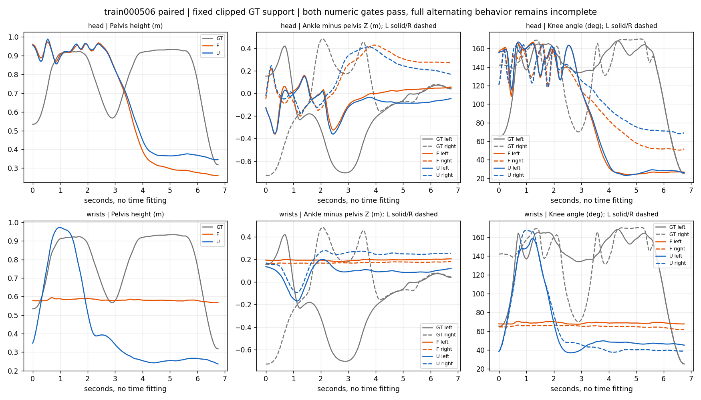

# F 固定损失配重评价：两个主配置均不支持局部行为修复

**F 完整运行已成功交付，但按输出前冻结的行为＋数值联合规则，train000506 的 head 与 wrists 均判为“不支持局部修复”。** 两个配置相对历史 U paired、相对自身 text/static 的五项数值门槛全部通过，完整交替弓步仍不完整。wrists 出现明显运动收缩，head 仍缺少中段回收。其余 10 个 paired source/config 中 9 个有至少一项数值退化；不能宣称整个开发面板已修复。

这是合并实验主会话的自检/重放与单 AI 粗审阅，不是新的独立 02 验收或人工验证。冻结阈值、随机计划、负例和来源没有改变；没有改论文主张。本报告关闭这一固定 F 候选的评价阶段。

## 运行身份、完整性和预算

| 项目 | 实际结果 |
| --- | --- |
| 运行目录 | `outputs/itm_rework/method/feature_balance_authorized_20261008_v1` |
| 用户依据 | 2026-10-08“再尝试一次，现在cuda:0 应该是空闲的。以后使用GPU不用我手动授权，你自行决定”；[长期 GPU 委托](../GPU_EXECUTION_POLICY_20261008.json)及[具体执行记录](../method/B0_FEATURE_BALANCE_AUTHORIZATION_20261008.json) |
| GPU | cuda:0 解析到 `GPU-d37bc466-7ddc-4a40-e1e6-952a58d89004`，RTX4090；完整预检 free=24119 MiB、compute_processes=0 |
| package / implementation | `a4189b89f1924af022c67dea71c02c2792e65f4a185775501b07d037fba51af9` / outputs v2 `db323ef515ede3252898f322f7badda10913aea64d67cb4abb1f3e9fc4605e30` |
| F final200 SHA256 | `d0e4f39f8c7ee5b980243baac48bc1bc02dc8f7c15c7a1f47f0adabb0b7e0ad3` |
| 原 initial / 历史 U | `3ad3c1bc…` / R final200 `91744ac5…`；U 使用历史 unit-guidance S1 完整输出，不重训或重采 |
| updates/exposures/samples/traces/checks | **200/600/60/240/48 全部 completed**；F60 与 U60 均有效，缺失/失败为 0 |
| 耗时 | 整队2493.120487秒（41.552分钟）；训练阶段107.508010秒，采样2385.612477秒，分别在600/3000/3600秒上限内 |
| 显存峰值 | worker allocated=677,558,784 bytes（约0.631 GiB），上限24 GiB |
| 实际计数 | MDM60,600调用/240,600 examples，encoder1,320 examples，caption660调用；240 trace 额外模型调用0 |
| 交付/自检 | 61 receipts、运行目录1696文件；1145份运行绑定文件及旧失败身份均通过，原status逐字节归档 |

原训练/采样入口未改；本次无warmup、续训、换卡、补采或重试。训练从共同initial加载、fresh AdamW，唯一F final200采样；50/100/150只保留。单次队列已完成，其目录不可复用；长期GPU自主使用授权继续有效，不再逐次要求用户批准。

证据：[执行摘要](../method/feature_balance_run_20261008_v1/execution_summary.json)、[完整运行文件索引](../method/feature_balance_run_20261008_v1/run_artifact_index.json)、[自检结果](../method/feature_balance_run_20261008_v1/result_verification.json)、[可重放脚本](../method/feature_balance_run_20261008_v1/verify_results.py)。

## 主负例：数值门槛通过，行为不完整

GT裁片第0帧已是左侧领先屈膝姿态，第135帧仍在下沉。要求的是可见的初始恢复、右侧前跨下沉、中段回收和末端下沉；不要求片段外的初始迈步或最终站直。按原20Hz坐标和全帧评价，无空间/时间拟合。

| 配置/指标 | U paired | F paired | F−U |
| --- | ---: | ---: | ---: |
| head global MPJPE (m) | 0.885039 | 0.792135 | −0.092905 |
| head root-relative MPJPE (m) | 0.252939 | 0.245008 | −0.007931 |
| head root路径RMSE (m) | 0.884330 | 0.809089 | −0.075242 |
| head关节位置proxy (m) | 0.892573 | 0.821648 | −0.070925 |
| head速度proxy RMSE (m/s) | 1.054499 | 1.041056 | −0.013443 |
| wrists global MPJPE (m) | 0.680360 | 0.639832 | −0.040528 |
| wrists root-relative MPJPE (m) | 0.220084 | 0.174087 | −0.045997 |
| wrists root路径RMSE (m) | 0.704598 | 0.651379 | −0.053218 |
| wrists关节位置proxy (m) | 0.598126 | 0.569547 | −0.028580 |
| wrists速度proxy RMSE (m/s) | 0.718675 | 0.638416 | −0.080259 |

五项比较保持 `ε=1e−6+1e−6*abs(reference)`、零退化幅度、root-relative严格改善。F相对自身text/static也全部通过；text/static相等，完整比较数值见 [decision.json](../../../outputs/itm_rework/protocol/feature_balance_evaluation_20261008_v2/decision.json)。没有因语义失败放宽或替换门槛。

- **head：F paired=FREV034、U paired=FREV007，均 incomplete。** 初始姿态较直立，随后下降为持续低蹲/近坐姿，GT可见的中段回收没有恢复。F后半段骨盆更低，不能把平均关节误差下降解释为完整弓步恢复。
- **wrists：F paired=FREV009、U paired=FREV001，均 incomplete。** F骨盆约0.58m、膝持续屈曲，缺少初始恢复、左右换侧及中段回收。U虽也失败，但F的动作变化进一步缩小：骨盆高度范围F0.027213m、U0.736050m、GT0.615907m；骨盆路径长度F0.151732m、U1.908289m；左右踝相对骨盆Z范围F0.023054/0.019159m、U0.368972/0.373302m。均为描述量，不增加新的成功阈值。

冻结规则明确持续低蹲或只变浅不能记complete。因此两个配置都 **not_supported**，并非仅因软件缺失而证据不足。数值增益保留为局部连续指标事实，不能升级为有效动态IMU控制。

## 其他 paired 退化与负例

下面只列超出原浮点松弛的指标；五项完整F/U值可在 [paired表](../method/feature_balance_run_20261008_v1/paired_effect_table.json)重建。G=global MPJPE，RR=root-relative，R=root路径，S=配置关节位置proxy，V=速度proxy。

| source/config | 数值退化项 | 行为自检 |
| --- | --- | --- |
| val000433 head | RR/R/S/V | F/U均不完整，右踢腿/返回问题保留 |
| val000433 wrists | S/V | F/U均不完整，踢腿后站立返回缺失 |
| val000382 head | G/R/S | F/U均uncertain，不能把含糊手部证据升为complete |
| val000382 wrists | G/RR/R/S/V | F/U均不完整；拍手伴下肢变形、末端手臂返回缺失 |
| val000139 head | G/RR/R/S/V | U粗顺序complete，F incomplete；新增初始站立阶段丢失 |
| val000139 wrists | G/R/S/V | F/U均不完整，早期步行/顺序问题保留 |
| train000027 head | G/RR/R/S/V | F/U均保留粗出拳→转身，但数值退化 |
| train000027 wrists | G/RR/R/S/V | F/U均保留粗行为，但global MPJPE从0.220273增至0.383062m |
| train004728 head | G/RR/R/S | F/U均不完整，后举/保持缺失或碎片化 |
| train004728 wrists | 无 | 五项均改善；F/U均有右侧后举/保持/放下粗证据，仍不认证精确方向/幅度或一般化 |

这9/10是预设数值守门条件的逐项回归标记，不是新成功率、统计显著性或普遍性能结论。共享的旧GT行为缺陷不重复计为F新退化：评价汇总在看F/U标签前修正为“F缺陷库存减去配对U库存”，并保留未知状态。所有numeric-zero、IMU-only、reversed、text/static/bypass行仍在120行人口与审阅中，没有只选择正例。

## 完整评价与审阅范围

保存了F/U120行、60个F−U、每臂36/合计72个臂内对照、36个差值之差；全部可比较。原标量指标、jerk/GT jerk、轴向范围/根路径、合法contact/GT contact与输出间距离均保留，contact仍只准入val000433/000382，其余NA。按arm/split/config/condition分别以3来源等权均值/min/max/有效n/计划n报告，不池化帧或合并配置。

完整263维uniform/D67/A196/balanced和旧5＋RIC3分块也保留。例如train000506 head的uniform下降约0.007724，但D67上升0.350029、balanced上升0.110006；wrists的balanced下降1.328125却伴运动收缩。说明不能单用整体或配重误差替代行为证据。

600 exposure四种损失来自同次预测，计划/噪声/真实长度及除3重放均通过；训练中噪声、t、dropout与权重变化，首末均值不构成受控收敛证明。48项完整motion软件等式全通过；F/U IMU-only不被错误纳入等式。240保存trace的身份、finite、mask、缺席分支及float32组合界全部重算通过，额外前向为0；F/U的x_t不同，未据跨轨迹差值作同状态因果解释。

120 notes按照seed20261003的冻结顺序先保存，再解码。审阅使用十个均匀姿态、全帧曲线与可播放全部帧页面；主弓步12行额外逐帧检查0..135的接触图。其他含糊行记uncertain。原U已看过，单AI审阅不称完全盲评、统计独立或人工验证。

## 软件验证、修正与限制

本轮评价回归 **40 passed**：原36项定向检查加4项“共享旧缺陷不算新F行为退化”的拒绝/未知测试。没有重跑已通过的155项运行实现全量验收。新增trace/绘图脚本仅处理保存数组，合成smoke明确不作为F效果证据，运行依赖和manifest未改。

最终重放用NumPy直接重算120×5主要指标及全部168项对照、门槛、分母、来源/输出hash，结果一致。核验脚本初次编写用了当前Python3.10不支持的星号下标语法，运行前SyntaxError；换为显式tuple后通过，未调用GPU或模型，未改变实验结果。

冻结notes中主负例附句“no missing middle recovery was found in skipped snapshot intervals”措辞不准确，其意是“未在十个姿态之间发现隐藏的中段恢复”。原分类、前句证据与side_order_return均明确为缺少恢复，全部帧自检仍支持incomplete；保留原notes/hash，作此文字澄清，不修改标签或门槛。

只有3个已暴露train来源＋3个development-val、1训练种子、K=1、历史配对对照。没有显著性、一般化、严格生成IMU闭环、相容文本编辑或真实设备认证。主要研究结论适当里程碑仍需另行只读复核，同会话自检不能冒充独立验收。

## 研究决策与唯一下一任务

**关闭当前固定F候选，不把它作为弓步修复或全面面板修复方案，也不继续搜索其他损失系数。** 保留000506和004728wrists的局部连续指标增益，同时明确运动塌缩、其他9项回归和主行为失败。

**下一任务是制定并冻结“训练充分性与动态塌缩”的受控诊断方案。** 先用固定状态/固定噪声的人口和完整动作行为判断，区分静态平均解、欠训练及表示/轨迹响应问题；不能用本轮动态训练首末loss直接证明欠训练或收敛，也不能直接追加updates。设计要明确唯一对照、分母、负例、停止规则及预算，再开展相应研究。此次未启动新诊断训练、权重搜索或新Q/V队列。

GPU选择与执行时机继续由主会话按用户长期委托自主决定，无需用户手动批准每次GPU使用；科学方案冻结和证据标准继续保留。
